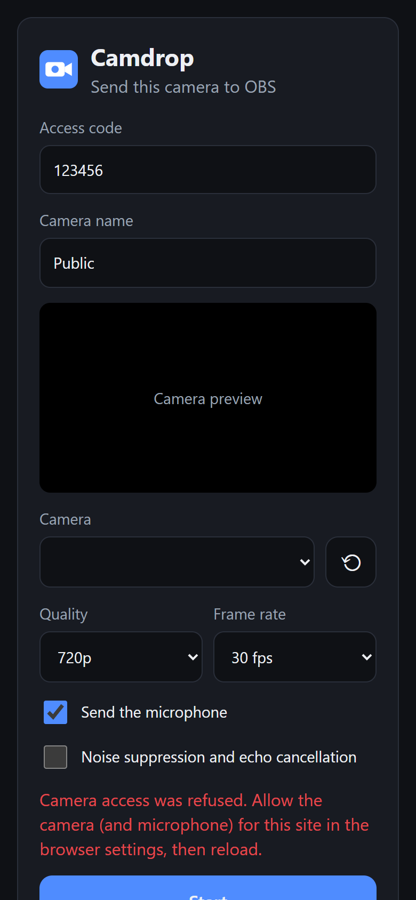
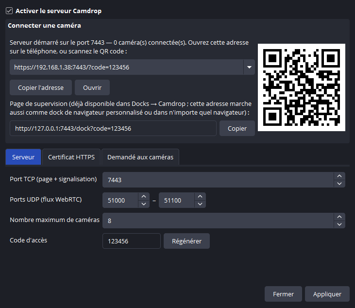
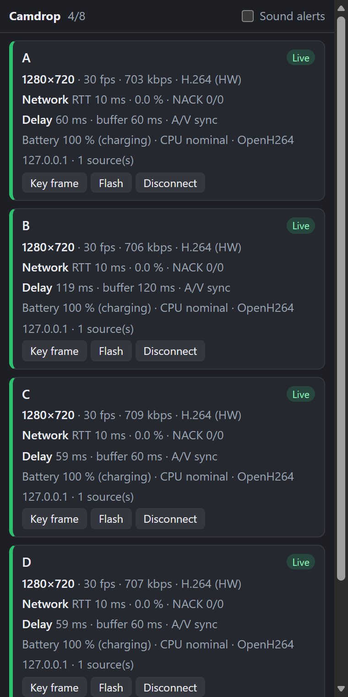
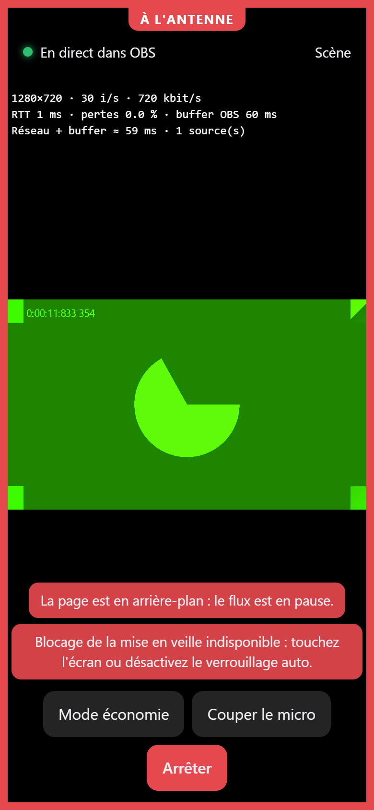
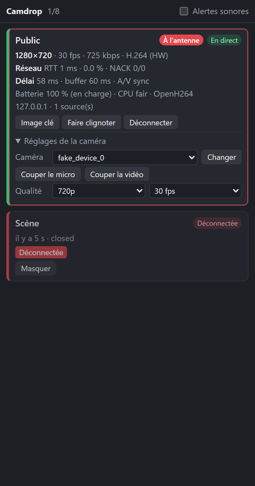

# Camdrop for OBS

**Use phones and browsers as low-latency cameras in OBS — no app, WebRTC, multicam.**

Camdrop is an OBS Studio plugin that runs a small HTTPS server on your PC. Open the address it shows
(or scan its QR code) on any phone, tablet or computer on the same network, type a name, allow the
camera and microphone, tap **Start**: the camera becomes an OBS source with 100–200 ms of latency.

> 🇫🇷 Documentation en français : [docs/fr/README.md](docs/fr/README.md)

<!-- TODO: demo GIF (phone → OBS) -->

| Phone | Settings (Tools → Camdrop) | Supervision dock |
| --- | --- | --- |
|  |  |  |
| **Phone on air (tally)** | | **Remote controls in the dock** |
|  | |  |

## Features

- **No app to install**: works in Chrome, Safari, Firefox, Edge (Android, iOS 16.4+, desktop).
- **Low latency**: WebRTC straight to the plugin over UDP, configurable jitter buffer per source,
  NACK/RTX retransmissions and key-frame requests instead of big buffers.
- **Several cameras at once**, each selectable by name in a **Remote camera (Camdrop)** source; a
  camera that reconnects is picked up again automatically.
- **Video + audio** (H.264, H.265/HEVC when the browser offers it, VP8; Opus), audio/video
  synchronised with RTCP sender reports.
- **Hardware decoding** (D3D11VA, VideoToolbox, VAAPI) with automatic software fallback.
- **Tally light**: the phone shows a red border when its source is on air and a green one when it is
  in the studio-mode preview.
- **Remote control from OBS**: from the dock, switch the camera or lens, zoom, torch, resolution,
  frame rate, mute the microphone or turn the video off, without touching the phone.
- **New cameras appear by themselves**: a source is added to the current scene (fitted to the
  canvas, hidden if you are live) when a new camera connects.
- **Supervision dock**: network, frame rate, delay, battery, CPU pressure and alerts for every camera.
- **Phone side**: front/back camera, screen sharing from desktop browsers, audio only, microphone
  choice, resolution and frame rate, screen kept awake (Wake Lock with a fallback), economy mode
  (black screen), live statistics.
- **Rotation**: per-source rotation for phones mounted sideways, and an orientation request
  (landscape / portrait) that reminds the camera operator to turn the phone.
- **Automation**: obs-websocket vendor requests for Stream Deck, Touch Portal, Bitfocus Companion or
  scripts.
- **Safe defaults**: server off until enabled, random access code, local network only, rate-limited
  code attempts, no telemetry.
- English and French.

## Comparison

| | Camdrop | VDO.Ninja | DroidCam / Camo | LensLink |
| --- | --- | --- | --- | --- |
| App to install on the phone | No | No | Yes | Yes (iPhone/iPad) |
| Android **and** iOS | Yes | Yes | Depends on the app | iOS only |
| Video arrives as a native OBS source | Yes | No (browser source) | Yes | Yes |
| Several cameras | Yes | Yes | See each app | See the app |
| Open source | Yes (GPL-2.0+) | Yes | No | Plugin: yes |
| Remote guests over the Internet | No (LAN only) | Yes | No | No |

Based on public information at the time of writing; check each project for details.

## Requirements

- **OBS Studio 32.2 or newer** (the plugin uses the FFmpeg and libdatachannel libraries shipped with
  OBS; 32.0/32.1 ship an older FFmpeg) on:
  - Windows 10/11 64-bit;
  - macOS 12 or newer (universal build, Apple Silicon and Intel);
  - Ubuntu 24.04 with OBS from the official PPA (`ppa:obsproject/obs-studio`). Other distributions
    and the Flatpak version of OBS need a build from source.
- Phone and PC on the same network (Wi-Fi 5 GHz recommended, PC on Ethernet ideally).

## Installation

Download the file for your system from the [releases](https://github.com/Wiibleyde/obs-camdrop/releases),
then restart OBS.

- **Windows**: extract `camdrop-x.y.z-windows-x64.zip` into `C:\ProgramData\obs-studio\plugins`
  (you get `...\plugins\camdrop\bin\64bit\camdrop.dll`).
- **macOS**: open `camdrop-x.y.z-macos-universal.pkg`. The package is not notarized yet: if macOS
  blocks it, right-click it and choose *Open*.
- **Ubuntu**: `sudo apt install ./camdrop-x.y.z-x86_64-linux-gnu.deb`.

## Quick start

1. **Tools → Camdrop**: tick **Enable the Camdrop server**, click **Apply**. Windows asks to allow
   OBS on the network: allow it for private networks.
2. On the phone, scan the QR code (or type the address, e.g. `https://192.168.1.20:7443`).
3. The first time, the browser warns about the certificate (self-signed): choose
   *Advanced → Continue*. To get rid of the warning, see the [HTTPS guide](docs/https.md).
4. Enter the access code and a name (e.g. `Stage`), allow the camera, tap **Start**.
5. A **Camdrop – Stage** source appears in the current scene. You can also add a **Remote camera
   (Camdrop)** source yourself and pick `Stage` (even before the phone connects).
6. **Docks → Camdrop** shows every camera with its alerts and, under *Camera controls*, its remote
   controls.

## Settings

**Plugin (Tools → Camdrop)**: server on/off, TCP port (page + signaling, default 7443), UDP port range
for WebRTC (default 51000–51100), access code, maximum number of cameras (8), certificate
(self-signed or imported PEM files, reloaded automatically when renewed), requested resolution,
frame rate (30 or 60) and maximum bitrate, preferred codec (H.264, H.265 or VP8), orientation
(any, landscape, portrait), hardware decoding, 10 ms Opus frames. *Studio* tab: tally light on the
phones, automatic sources for new cameras.

**Source**: camera name, **buffer (ms)**, audio on/off, rotation (0/90/180/270°). The buffer is the
delay used to absorb network jitter: 40–60 ms on a good network, 80–150 ms on a busy Wi-Fi. When
several sources show the same camera, the largest buffer applies.

Rotating a phone switches its picture between landscape and portrait. With the bounding box *Scale
to inner bounds* (what automatic sources use, and what *Fit to screen*, Ctrl+F, sets), the layout of
the scene does not move when that happens.

## Automation (obs-websocket)

Camdrop registers the obs-websocket vendor `camdrop`. Send `CallVendorRequest` with
`vendorName: "camdrop"` and one of these `requestType`s:

| Request | Data | Effect |
| --- | --- | --- |
| `GetCameras` | – | Connected cameras: state, tally, resolution, fps, network, battery, controls |
| `SetCameraControl` | `name` + any of `deviceId`, `facing` (`user`, `environment`, `toggle`), `zoom`, `torch`, `height` (480/720/1080), `fps` (30/60), `muted`, `video` (`camera`/`none`) | Changes the camera on the phone |
| `RequestKeyframe` | `name` | Asks the phone for a key frame |
| `Identify` | `name` | Flashes the phone screen |
| `Disconnect` | `name` | Disconnects the phone |

Responses contain `ok` (and `error` when it is false). The vendor also emits the events
`CameraConnected` and `CameraDisconnected` (`name`, `reason`).

```json
{"op": 6, "d": {"requestType": "CallVendorRequest", "requestId": "1", "requestData": {
  "vendorName": "camdrop", "requestType": "SetCameraControl",
  "requestData": {"name": "Stage", "zoom": 2, "torch": true}}}}
```

## Latency

| Step | Estimated (ms) |
| --- | --- |
| Phone camera capture | 30–60 |
| Hardware encoding | 10–30 |
| Local network | 2–10 |
| Jitter buffer (source setting) | 20–60 |
| Decoding + OBS rendering | 20–50 |
| **Total** | **80–210** |

Measured from capture to the OBS source with the page's test mode (`?test=clock`, Chromium software
encoder on the same PC, 720p30): median **122 ms** with the default 60 ms buffer, 83 ms with 20 ms,
70 ms with 0 ms. With 10 % simulated packet loss, NACK/RTX recovers every packet at 60 ms of buffer.

Tips: PC on Ethernet, phone on 5 GHz Wi-Fi with power saving off, 30 fps unless you need 60.
On a shared Wi-Fi, plan 4 to 6 phones in 1080p30; a dedicated Wi-Fi 6 access point handles about 8.

## Troubleshooting

See the [FAQ](docs/faq.md): firewall, guest Wi-Fi / client isolation, iOS specifics, certificates.

## Building

Camdrop uses the official [obs-plugintemplate](https://github.com/obsproject/obs-plugintemplate)
build system. On Windows with Visual Studio 2022 and CMake 3.28+:

```powershell
cmake --preset windows-x64
cmake --build --preset windows-x64
```

The first configuration downloads the OBS sources and `obs-deps` (FFmpeg, libdatachannel, mbedTLS,
Qt) and builds libobs. macOS uses the same flow (`cmake --preset macos`). On Ubuntu, install OBS from
the PPA and the packages listed in `.github/scripts/utils.zsh/setup_ubuntu`, then
`cmake --preset ubuntu-x86_64`: mbedTLS 3 and libdatachannel are downloaded and linked statically.
See [CONTRIBUTING.md](CONTRIBUTING.md).

### How it works

```
Phone browser ──HTTPS──▶ page + WebSocket (signaling, telemetry) ─┐
      │                                                           │  Camdrop plugin (OBS)
      └──────── WebRTC (UDP, DTLS-SRTP) ──▶ RTP receiver ──▶ jitter buffer ──▶ FFmpeg ──▶ OBS source
```

- `src/net`: HTTPS + WebSocket server on one port (mbedTLS), self-signed certificate generation.
- `src/core`: camera sessions, signaling, SDP tuning, named channels shared by sources.
- `src/media`: RTP/RTCP, NACK/RTX, frame assembly (H.264, H.265, VP8), A/V clock sync, decoders, playout.
- `src/obs`: the OBS source, automatic sources, obs-websocket vendor. `src/ui`: Qt settings dialog and
  dock. `data/web`: phone page and dock page.
- `src/platform`: the only OS-specific code (network interfaces, sockets).

## License

GPL-2.0-or-later, like OBS. Third-party licenses: [THIRD-PARTY-NOTICES.md](THIRD-PARTY-NOTICES.md).
Camdrop is not affiliated with the OBS Project.
